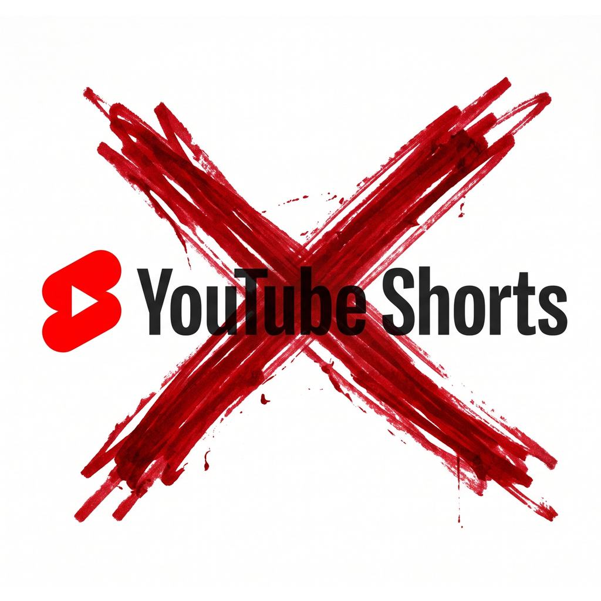

# YouTube Shorts Blocker

<p align="center">
  
</p>

> noooo youtube shorts — YouTube 쇼츠 접속을 막아 쇼츠 중독을 끊어주는 Chrome 확장 프로그램.

YouTube **쇼츠(Shorts)** 의 무한 스크롤에 빠지지 않도록 막아주는 확장입니다.
팝업의 토글 두 개로 동작을 고를 수 있습니다.

## 기능

- **쇼츠 차단 on/off** (마스터 스위치)
- **쇼츠 영상 표시 방식** 토글
  - 켜짐(표시): `/shorts/<id>` → `/watch?v=<id>` 로 보내 같은 영상을 **일반 플레이어**로 시청
  - 꺼짐(차단): 확장 자체의 **차단 안내 페이지**로 보내 영상 자체를 띄우지 않음
- 홈·검색·사이드바의 **쇼츠 칸/링크(진입점) 숨김** — 클래스 게이트 CSS(`:has()`)로
  초기 숨김을 적용하고, 새로 그려지는 쇼츠도 CSS로 자동 처리
- YouTube는 SPA(단일 페이지 앱)라 앱 내부 이동도 함께 처리
  (내비게이션 이벤트 + 폴링 안전망)
- 설정은 `chrome.storage.sync` 에 저장
- **다국어 지원**: 브라우저 언어에 맞춰 UI가 자동 표시 (`chrome.i18n` / `_locales`)
  — 영어(기본)·한국어·일본어·중국어(간체)·스페인어·프랑스어·독일어. 미지원 언어는 영어로 폴백.

## 기술 / 정책 메모

- **Manifest V3** 기반 (Manifest V2는 지원 종료).
- 권한은 최소화: `storage` + `*://*.youtube.com/*` 호스트 권한만 사용.
- Chrome Web Store 정책의 **단일 목적(single purpose)** 원칙에 맞춰
  "쇼츠 차단" 하나의 기능만 수행합니다.

## 설치 (개발자 모드)

1. 이 저장소를 클론하거나 다운로드합니다.
2. Chrome 주소창에 `chrome://extensions` 입력 후 이동.
3. 우측 상단 **개발자 모드**를 켭니다.
4. **압축해제된 확장 프로그램을 로드** 클릭 → 이 폴더(`noshorts`)를 선택.
5. YouTube 쇼츠 URL에 접속해 동작을 확인합니다.

## 프로젝트 구조

```
noshorts/
├── manifest.json        # MV3 매니페스트
├── _locales/            # 다국어 메시지 (en/ko/ja/zh_CN/es/fr/de)
│   └── <lang>/messages.json
├── src/
│   ├── content.js       # 쇼츠 감지·차단/리다이렉트 + 숨김 on/off 클래스 토글
│   ├── hide.css         # 쇼츠 진입점 숨김 규칙(:has(), 플래시 없음)
│   ├── blocked.html     # 차단 안내 페이지
│   ├── blocked.js       # 차단 페이지 버튼 동작 + i18n 적용
│   ├── popup.html       # 토글 UI (차단 on/off, 영상 표시)
│   └── popup.js         # 토글 상태 저장/표시 + i18n 적용
└── icons/               # 확장 아이콘 (16/32/48/128) + logo.png(마스터)
```

## 배포 / 스토어 등록

- 개인정보처리방침: [PRIVACY.md](PRIVACY.md) (데이터 미수집)
- Chrome Web Store 리스팅 원고(복붙용): [store/listing.md](store/listing.md)

## 라이선스

[MIT](LICENSE)

## 개발 검증

별도 빌드나 npm 의존성 설치 없이 저장소 폴더를 확장으로 로드합니다.

- `node --test tests/content.test.cjs`: 초기 설정, DOM 생성 시점, SPA 이동 회귀 검사
- `python tests/browser-smoke.py`: Playwright와 `/usr/bin/chromium`이 설치된 환경에서 UI·CSS 검사

브라우저 검사는 Chrome API와 YouTube 응답을 대체한 로컬 검사이며, 실제 확장 로드나 YouTube 최신 DOM 전체를 검증하지 않습니다. 관리형 브라우저의 확장 설치 정책이 허용하는 경우 개발자 모드로 로드해 추가 확인합니다.

## 스토어 자동 업데이트

`main` push 시 Chrome Web Store 업데이트 ZIP을 만들고, 계정 연결 후 자동으로 심사를 요청합니다. 최초 OAuth 연결과 버전·재시도 정책은 [자동화 설정 안내](store/automation.md)를 참고하세요.
